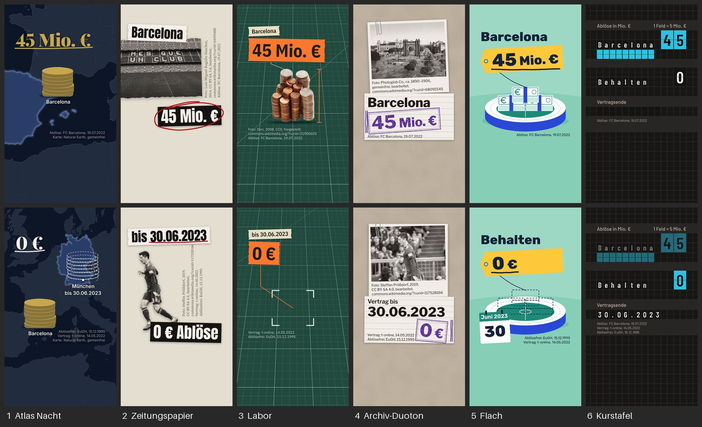

# Look-Katalog: sechs Bildwelten, sechs Stimmen

Stand 28.10.2026, Überarbeitung nach der Kritik vom selben Abend. Linus' Wünsche: Jedes Video soll **anders aussehen und sich anders anfühlen** („nicht alles so goldmäßig“), **echte Bilder von Live-Situationen** zeigen und die **Stimmen variieren**. Dieser Ordner setzt das um:

- sechs Looks, je ein Blatt (`<look>.md`) und eine stumme Probe (`probe-<look>/`, 12 s, zwei Beats);
- Hausregeln, die für jeden Look gelten (Kurzfassung unten, maßgeblich bleibt `studio/DESIGN.md`);
- echte Fotos und Clips über `factory/werk/bilder.py` (nur freie Lizenzen, mit Credits);
- Stimmen- und Look-Rotation über alle sechs Casting-Stimmen (`voices/rotation.json`).



`belege/vergleich.jpg`: je Look zwei Bilder aus dem gerenderten MP4. **Oben Beat 1**, in allen Looks derselbe Inhalt: „Barcelona bietet 45 Millionen Euro“ (Ort, Zahl, ein Held, ein Marker). **Unten Beat 2**, wie der Look weitergeht: „Behält Bayern ihn bis Juni 2023, gibt es danach 0 €.“ Dort zeigt jeder Look seinen eigenen Übergang und Takt.

## Die sechs Looks

| Nr | Look | Medium | Grund | Held | Takt, Übergang | gesucht | Irrtum, Verlust |
|---|---|---|---|---|---|---|---|
| 1 | [Atlas Nacht](atlas-nacht.md) | Seekarte bei Nacht | dunkel, kalt (Navy) | Karte, beleuchtete Gegenstände | ruhig; Zoom-out-Fahrt zum zweiten Ort | Gold | Rot + Durchstrich |
| 2 | [Zeitungspapier](zeitungspapier.md) | Zeitungsseite, Collage | hell, neutral (Zeitungsgrau) | echte Fotos (und Clips) im Rasterdruck, Figur ausgeschnitten | dicht; neues Stück alle 0,5–0,7 s, harter Schnitt auf eine neue Seite | Rotstift | schwarzer Zensurbalken |
| 3 | [Labor](labor.md) | Werkbank mit Schneidematte | dunkel, grün | echter Gegenstand, freigestellt | ruhig; Kamerafahrt auf der Schiene | Orange (Markierband) | Rot + ✗ |
| 4 | [Archiv-Duoton](archiv-duoton.md) | Akte auf Graupappe | hell, warm | Abzug in warmem Schwarzweiß | ruhig, schwer; Tippen, Stempeln, Stapel | Violett (Stempel) | Rot + Durchstrich |
| 5 | [Flach](flach.md) | eigene flache Zeichnung | hell, frisch (Minze) | Illustration, Foto-Einlage am Anfang | lebhaft; Ploppen, Wachsen, Morph | Gelb (Preisschild) | Rot + ✗ |
| 6 | [Kurstafel](kurstafel.md) | Fallblatt-Anzeige | dunkel, neutral | Tafel mit Zeilen und Modulbalken | getaktet; Klappen, Abdunkeln | Cyan (Klappe) | Rot (Klappe) + „−“ |

**Unterschiede, nachgerechnet** (`werkzeug/` per Skript, CIE76): Je zwei Looks unterscheiden sich in mindestens 4 von 6 Achsen (Helligkeit, Temperatur, Bildträger, Takt, Schriftart, Marker-Art); am nächsten liegen Atlas/Labor, Labor/Archiv, Labor/Kurstafel, Zeitungspapier/Archiv, Zeitungspapier/Kurstafel und Zeitungspapier/Labor mit je 4. Gründe: drei dunkel (L* 8, 16, 28), drei hell (L* 73, 83, 89). Zwei Gründe liegen mindestens ΔE 16 auseinander (Zeitungspapier/Archiv), zwei Akzente mindestens ΔE 26 (Gold/Gelb). Gold oder Gelb tragen zwei von sechs Looks (Atlas, Flach); der zitronige Gelbton von Flach liegt ΔE 26 vom Gold entfernt.

| Achse | Atlas | Zeitung | Labor | Archiv | Flach | Kurstafel |
|---|---|---|---|---|---|---|
| Helligkeit (L* Grund) | dunkel (8) | hell (89) | dunkel (28) | hell (73) | hell (83) | dunkel (16) |
| Temperatur | kalt | neutral | grün | warm | frisch | neutral |
| Bildträger | Zeichnung | Foto, Clip | Foto | Foto | Zeichnung (+ Foto-Einlage) | Daten |
| Takt | ruhig | dicht | ruhig | ruhig | lebhaft | getaktet |
| Schrift | Serife | Grotesk schmal | Grotesk schmal | Grotesk breit | gerundet | Grotesk schmal |
| Marker | Hand | Hand (Rotstift) | Lineal | Stempel | Pinsel | Mechanik |

**Was die Kritik vom 28.10. geändert hat:**
- **Labor** war die Standard-KI-Vorlage (fast weißer Grund, Serifen-Zahl, ein Kobalt-Akzent, BANNED 12). Jetzt: Schneidematte in Perspektive, IBM Plex Sans Condensed, Orange.
- **Archiv** war fast eine Umfärbung von Atlas (Petrol/Ocker gegen Navy/Gold, ΔE 10–14). Jetzt: helle Graupappe, Violett, Libre Franklin, Stempel und Kopierstift.
- **Kurstafel** war ein dunkles Dashboard mit einem Balken auf leerem Grund. Jetzt: Fallblatt-Anzeige bis an alle Ränder, gegebener und gesuchter Wert, alle Zeichen ≥ 48 px.
- **Flach**: Geld ist jetzt als Geld erkennbar (Bündel mit €-Zeichen und Banderole), das Gelb ist ein Preisschild statt eines Pillen-Kastens, die Zahl hat 173 px.
- **Gleiches Gerüst überall**: Jede Probe hat jetzt einen zweiten Beat mit eigenem Übergang (Fahrt, Schnitt, Schiene, Stapel, Morph, Klappen) und stellt den Helden anders (Karte bis zum Rand, Collage links mit Credit-Spalte, Gegenstand in der Mitte, Abzug oben und Karte unten, Illustration mit Schild an der Schnur, Tafelzeilen).
- **Live-Situationen**: ein echtes Spielfoto (Lewandowski im Spiel für den FC Bayern, 2019) in Zeitungspapier und Archiv. Der echte Clip (volles Camp Nou 2022, CC BY-SA 4.0) ist ausgewählt und im Code eingebaut, aber noch nicht geladen und darum im Render ungeprüft: upload.wikimedia.org antwortete am 28.10. dreimal mit 429 und `Retry-After: 600`. Bis dahin zeigt Seite 1 dasselbe Stadion als Foto; `werkzeug/fotos.py` holt den Clip beim nächsten Lauf, `proben.py` baut ihn dann von selbst ein.

**Identitäten und Looks.** Editorial, Diagramm und Atlas aus DESIGN.md §7 sind Szenen-Grammatiken: wie ein Diagramm sich aufbaut, wie eine Karte zoomt. Ein Look gibt ihnen Material, Farbe und Takt. Ein Diagramm im Look Zeitungspapier ist eine Druckschwarz-Linie mit Rotstift-Marker; auf der Kurstafel ist es eine Reihe von Klappmodulen.

## Hausregeln für alle Looks (Kurzfassung)

Maßgeblich ist `studio/DESIGN.md`. Diese Regeln wechseln mit dem Look **nicht**:

1. **Lesefenster** x 108–972, y 168–1330. Untertitel-Zone y 1350–1490, App-Zone ab 1520. Tor: `npx hyperframes check --caption-zone "x0=0;y0=.693;x1=1;y1=1;severity=error"`.
2. **Typo-Mindestgrößen:** Text ≥ 48 px (Standard 52), Credits ≥ 34 px, Zahl ≈ 9 % der Bildhöhe (173 px), Namen ≈ 6,5 % (124 px). Ist „45 Mio. €“ in 173 px breiter als das Lesefenster, steht die Einheit in 124 px auf derselben Grundlinie (Flach, Archiv). Ausnahme nur für schmale Schriften: Anton 150 px (Zeitungspapier). Jede Zeile ist gemessen ≤ 864 px breit (`werkzeug/messen.mjs`, echte Schrift in Chrome). Ziffern `lining-nums`, zählende Ziffern `tabular-nums`. Echtes Minus, geschütztes Leerzeichen („45 Mio. €“).
3. **Cue-Timing:** Eintritt am Wortanfang −2 Bilder (±150 ms), Marker zeichnen auf dem Wort. Nach jeder Landung ≥ 1,2 s Halten; Text steht ≥ 1,7 s. Die Kamera steht beim Lesen; Fahrten dauern 0,5–0,6 s.
4. **Ein Held je Szene, der kein Text ist;** ≥ 50 % der Bilder sind Bild statt Text. Bilder nur, wenn sie Inhalt tragen.
5. **Keine Musik,** keine Geräusche unter der Stimme, keine Whoosh-Übergänge, keine Wisch- oder Kreuzblenden.
6. **Farbe ist Bedeutung:** je Look genau eine Farbe für die gesuchte Größe und eine für Irrtum oder Verlust (Tabelle unten). Der Irrtum hat immer ein zweites Merkmal (Durchstrich, ✗, „−“, Zensurbalken).
7. **Kontrast nach WCAG:** Text ≥ 4,5 : 1 (fett ab 48 px ≥ 3 : 1), Marker und Formen ≥ 3 : 1. `check` meldet 0 Kontrastfehler; auch Abgedunkeltes bleibt ≥ 3 : 1 (Kurstafel: 50 % statt 35 %).
8. **Echte Bilder nur mit freier Lizenz** und mit Credit im Bild und in `credits.json` (Abschnitt unten).
9. **Seek-sicher:** nur `fromTo`, Zufall nur mit festem Startwert, alle Zeiten aus Cues.
10. **Schriften nur lokal** (woff2, OFL), je Look eigene `@font-face`-Namen; Liste in `werkzeug/schriften.json`.
11. **Ein Video, ein Look.** Eine Serie behält Look und Stimme.
12. **Kein Standard-Look:** kein heller Creme-Grund mit Serife, kein dunkler leerer Grund mit einem einzigen Leuchtakzent, keine Pillen-Chips (DESIGN.md §8, HyperFrames BANNED). Jeder Look ist aus einem Medium abgeleitet (Karte, Zeitung, Werkbank, Akte, Zeichnung, Anzeigetafel), und das Medium bestimmt, wie sich etwas bewegt.

### Akzent und Rot je Look

| Look | gesuchte Größe | Irrtum oder Verlust | Rot bedeutet |
|---|---|---|---|
| Atlas Nacht | Gold `#C9A84C` | Rot `#E07A5F` + Durchstrich | Irrtum, Verlust |
| Zeitungspapier | Rotstift `#B8161D` (Kreis, Pfeil, Unterstreichung) | schwarzer Zensurbalken `#161514` | **Signal: hier hinsehen** (einzige Ausnahme, braucht Linus' Ja) |
| Labor | Orange `#FF7A2F` (Markierband, Maßlinie) | Rot `#FF8F8F` + ✗ oder Durchstrich | Irrtum, Verlust |
| Archiv-Duoton | Violett `#5B2C94` (Stempel, Kopierstift) | Rot `#A3221B` + Durchstrich | Irrtum, Verlust |
| Flach | Gelb `#FFC93C` (Preisschild, Zahl in Tinte darauf) | Rot `#A51C34` + ✗ | Irrtum, Verlust |
| Kurstafel | Cyan `#2EC4E6` (Klappe) | Rot `#D93B42` (Klappe) + „−“ | Verlust, Irrtum |

**Die Ausnahme im Zeitungspapier:** Der Look lebt vom Rotstift des Redakteurs. Ein Video hat nur einen Look, und eine Serie behält ihn; innerhalb dessen, was man am Stück sieht, bleibt die Regel eindeutig. Sagt Linus nein, nimmt der Look den **Blaustift** (`#1F4FB5`, ebenfalls Redaktionswerkzeug) als Signal, und Rot bleibt Irrtum. Kein Gelbmarker: Das brächte einen dritten Gelb- oder Goldton in den Katalog.

## Echte Bilder

**Woher.** `factory/werk/bilder.py` fragt die Commons-API (`generator=search`, Dateiarten `bitmap`, `drawing`, `video`) und behält nur gemeinfreie Dateien, CC0, CC BY, CC BY-SA und „ohne bekannte Rechte“ (Library of Congress, Flickr Commons). NC, ND, GFDL allein und unklare Fälle fliegen raus. `bilder.vorlagen(titel)` liest die Lizenz-Vorlagen der Dateiseite und schreibt sie in `credits.json` (Arc de Triomf: `PD-old-70-expired`, `LOC-image`; Münzen: `Cc-zero`; Spielfoto und Clip: `Cc-by-sa-4.0`). Agentur- und Pressefotos, Google-Bildersuche und YouTube sind tabu.

**Höflich laden.** User-Agent mit Projektname und Kontakt, 2 s Pause zwischen zwei Abrufen, alles nacheinander. Bei HTTP 429/503 oder „Suche ausgelastet“ wartet der Baustein mindestens so lange, wie der Server sagt, und gibt nach fünf Absagen auf. **Verlangt der Server mehr als 120 s** (am 28.10. sagte upload.wikimedia.org `Retry-After: 600`), bricht er sofort ab und nennt die Wartezeit, statt früher zu fragen. Vorschaubilder kommen über `thumb.wikimedia.org` (iiurlwidth), Originale nur, wenn nötig.

**Was ein Foto darf.** Es zeigt, worüber gesprochen wird: den Ort, die Person, den Gegenstand, das Ereignis. Echte Personen nur auf echten, lizenzierten Fotos, nie per KI erzeugt und nie so bearbeitet, dass etwas Falsches behauptet wird. Keine Privatpersonen im Mittelpunkt; Zuschauer im Hintergrund eines Spielfotos sind in Ordnung. Dateien mit der Commons-Einschränkung „personality“ lösen einen `BildHinweis` aus und lassen sich nur mit `personen_freigabe="Grund"` laden; der Grund steht in `credits.json`. Werbung wird weggeschnitten oder abgedeckt; ein Gegenstand wird mit dem beschriftet, was er ist (Kritik: kein Museumsball als „Angebot aus Barcelona“).

**Live-Situationen in den Proben.**

| Probe | Bild | Lizenz | zeigt |
|---|---|---|---|
| Zeitungspapier, Seite 1 | Clip: Camp Nou beim Zuschauer-Weltrekord im Frauenfußball, Frühjahr 2022 (Jove); **noch nicht geladen** (Commons 429), bis dahin Foto Camp Nou (Lmbuga, 2014, CC BY-SA 3.0) | CC BY-SA 4.0 | den Verein, der bietet, lebendig |
| Zeitungspapier, Seite 2 (ausgeschnitten); Archiv, Beat 2 | Foto: Lewandowski im Spiel für den FC Bayern, 9.3.2019 (Steffen Prößdorf) | CC BY-SA 4.0, personality, Freigabe vermerkt | die Person, um die es geht |
| Flach, Bild 0 | Foto: Camp Nou, Ränge mit „Més que un club“, Spielfeld (Lmbuga, 2014) | CC BY-SA 3.0 | den Ort, bevor er zum Modell wird |
| Labor | Foto: Münzstapel (Dori, 2008) | CC0 | Geld als Gegenstand, beschriftet mit dem Betrag |
| Archiv, Beat 1 | Foto: Arc de Triomf, Photochrom (Photoglob Co., ca. 1890–1906) | gemeinfrei | den Ort (bewusst altes Bild, siehe Datumsregel) |

**Behandlung je Look.**

| Look | Foto | Werkzeug |
|---|---|---|
| Atlas Nacht | Duoton Navy → Creme, als Beleg | `bilder.duoton(…, "#0E1726", "#F5F0E8")` |
| Zeitungspapier | Graustufen, ausgerissen, Rasterdruck; Clips ebenso | `bilder.graustufen`, im Video HyperFrames „Monochrome Screen Print“ (`werkzeug/zeitung-raster.json`) auf `` und `<video>` |
| Labor | echte Farbe, freigestellt | `bilder.freistellen` (`hyperframes remove-background`, lokales Modell; sonst rembg), Rückfall Flutfüllung vom Rand |
| Archiv-Duoton | Duoton Tinte → Papier, als Abzug | `bilder.duoton(…, "#1E1B17", "#F3EFE6")` |
| Flach | Foto-Einlage in Farbe, verwandelt sich in die Zeichnung | Ausschnitt, sonst unverändert |
| Kurstafel | Foto-Einlage als Feld der Tafel, Duoton Klappe → Ziffer | `bilder.duoton(…, "#141414", "#F2F0EA")` |

`bilder.graustufen` und `bilder.duoton` nehmen `gewichte=(r, g, b)` wie einen Farbfilter vor dem Schwarzweißfilm (Camp Nou: mit Rotfilter bleibt die gelbe Sitz-Schrift hell).

**Credits.** Im Bild 2–5 Zeilen mit 34 px: „Foto: Urheber, Jahr, Lizenz, bearbeitet,“ und der Kurzlink `commons.wikimedia.org/?curid=<id>`. Ort je Look: Atlas in der Credit-Ecke, Zeitungspapier senkrecht an der Bildkante, Labor unter der Fußlinie, Archiv auf dem Rand des Abzugs, Flach unter dem Foto, Kurstafel als Aufdruck. Daneben `credits.json` mit Urheber, Lizenz, Lizenz-Link, Lizenz-Vorlagen, Seite, Original, Abrufdatum, Bearbeitung, Inhalt und Credit-Zeile (`bilder.credits_eintrag`). **Eine Bearbeitung von CC BY-SA (Duoton, Raster, Ausschnitt) steht wieder unter CC BY-SA**; `credits.json` vermerkt das in `lizenz_bearbeitung`.

**Jahr im Credit.** Ein genaues Datum wird zum Jahr („2014“), ein Zeitraum bleibt Zeitraum („1940–1949“), ein nacktes Jahr oder „um 1890“ wird „ca. 1890“. Ein geprüftes Jahr schlägt die Schätzung (`jahr="ca. 1890–1906"`, Quelle in `datum_foto_quelle`: Library of Congress, LCCN 2017660387). Zeigt ein Foto einen Gegenstand mit eigenem Datum, wird es getrennt geführt (`objekt="Ball 1940er"` → „Foto: Musée national du sport (Ball 1940er), gemeinfrei“; `datum_objekt` statt `datum_foto`).

**Kurze echte Clips.** `bilder.suche(…, arten=("video",))`, dann `bilder.video_fassungen(treffer)` (Transcodes 480p, 720p …) und `bilder.lade(treffer, ziel, fassung=…)`. Ein Video wird nie still gegen ein Standbild getauscht: Ein Original über 40 MB oder `vorschau=True` bricht mit `BildFehler` ab. `werkzeug/fotos.py` kürzt mit ffmpeg auf die nötige Länge, schneidet aus, nimmt den Ton heraus und setzt alle 6 Bilder ein Schlüsselbild (HyperFrames springt beim Rendern genau). Im Video stumm (`<video muted>`), höchstens 6 s je Stück.

**Beispiel zum Nachmachen:** `werkzeug/fotos.py` holt alle Fotos und den Clip der Proben, behandelt sie und schreibt `credits.json`; was Commons gerade ablehnt, lässt es aus und nennt die Wartezeit.

## Stimmen

**Wie die Stimmen entstehen** (Linus' Frage): ElevenLabs, Modell `eleven_v4`, fertige deutsche Stimmen aus der Bibliothek. Das ganze Skript geht in einem Auftrag hinaus, damit Betonung und Pausen über Sätze hinweg stimmen; zurück kommen Ton und Wortzeiten. Danach Mastering auf −16 LUFS und der Hör-Check mit Whisper (`docs/VIDEO-PIPELINE.md` §4). Im Goldstandard lief das über den claude.ai-Connector, in der Fabrik über den Adapter `factory/werk/stimme/elevenlabs.py`. Kosten: etwa 1 Credit je Zeichen.

**Pool** (alle sechs aus dem Blind-Casting, `voices/rotation.json`). Gezählt wird in Videominuten der letzten 14 Tage, nur im Profil Linus; Ziel ist die Mitte, die Mitten ergeben zusammen 100 %:

| Stimme | voice_id | Rolle | Ziel (Mitte) |
|---|---|---|---|
| Jonas | `xlbJQnFFGB01bv7HK5CZ` | Hauptstimme, Platz 1 bei beiden Brüdern; Stimme des Morgen-Briefings | 37,5 % |
| Thomas | `vv3bG6FrcGtmeOdRSriS` | Zweitstimme, Platz 2 bei beiden; Märkte-Karte | 17,5 % |
| Konrad Fichte | `loz8rFIyEGZqFnwI07Yo` | Pool | 12,5 % |
| Lea Voss | `BWfLElHIfDtE09FrC6tz` | Pool, im Casting als Wissenschaftsstimme geführt | 12,5 % |
| Hans | `yamcvgNdKmgh0Ron7Bsz` | Pool | 10 % |
| Victoria | `iiABcyfvsoqbxubwCKFM` | Pool | 10 % |

**Stammformate** (Bereich „Heute“, täglich, keine Serien): Weltlage-Briefing mit Jonas im Look Zeitungspapier (Rückfall Konrad/Atlas Nacht), Märkte-Karte mit Thomas im Look Kurstafel (Rückfall Victoria). Sie zählen beim Anteil mit, aber nicht bei der Regel „aktive Serien paarweise verschieden“; in „Heute“ haben zwei aufeinanderfolgende Karten mit Ton verschiedene Stimmen und Looks. Damit bekommt Jonas das größte tägliche Volumen, und Weltlage und Märkte-Karte unterscheiden sich in Stimme und Look.

**Regeln:**
1. **Eine Stimme je Serie.** Alle Teile behalten Stimme und Look; so erkennt man die Serie wieder.
2. **Aktive Serien eines Profils** (2–3 im Bereich „Für dich“) haben paarweise verschiedene Stimmen und Looks. Dann folgen dort nie zwei Videos verschiedener Serien mit gleicher Stimme oder gleichem Look.
3. **Eine Schwelle:** 5 Prozentpunkte Abstand von der Mitte. Stimme für eine neue Serie: Kandidaten sind alle Stimmen außer denen der übrigen aktiven Serien. Liegt ein Kandidat mehr als 5 Punkte unter seiner Mitte, bekommt der mit dem größten Rückstand die Serie. Sonst die erste Wahl des Kanals, wenn sie nicht mehr als 5 Punkte über ihrer Mitte liegt; sonst die Alternative; sonst der größte Rückstand. Kanäle ohne Vorschlag nehmen Jonas.
4. **Ist das Briefing allein zu groß** (Jonas über 42,5 %, obwohl keine neue Serie ihn bekommt), spricht an jedem zweiten Tag die Rückfallstimme des Briefings.
5. **Looks rotieren ohne Anteile:** erste Wahl des Kanals, wenn keine andere aktive Serie des Profils sie hat; sonst die Alternative; sonst der am längsten nicht benutzte Look.
6. **Bruder:** keine ElevenLabs-Stimme, bis ElevenLabs schriftlich für Hörer unter 18 freigibt (Mail offen). Bis dahin gilt die Stimme, die die Entscheidung am 1.11. für beide Profile freigibt (Kandidaten in VIDEO-PIPELINE §4); bis zu dieser Entscheidung bekommt er Inhalte als Erklär-Karte ohne Stimme. Seine Videos zählen nicht beim Anteil; die Look-Rotation gilt für ihn sofort.

**Startvorschlag je Serien-Kanal** (nach den ersten Bewertungen anpassen):

| Kanal | Look | Stimme | Alternativen (Look / Stimme) |
|---|---|---|---|
| Rhetorik & Charisma | Archiv-Duoton | Jonas | Zeitungspapier / Victoria |
| Denken & Philosophie | Flach | Hans | Archiv-Duoton / Lea Voss |
| Wissenschaft | Labor | Lea Voss | Flach / Jonas |
| Geopolitik & Geschichte | Atlas Nacht | Konrad Fichte | Archiv-Duoton / Jonas |
| Wirtschaft & Märkte | Kurstafel | Thomas | Zeitungspapier / Jonas |
| Disziplin | Zeitungspapier | Hans | Labor / Konrad Fichte |
| Stil & Auftreten | Labor | Thomas | Zeitungspapier / Victoria |
| Bücher | Archiv-Duoton | Victoria | Flach / Lea Voss |
| Schule-Transfer (Bruder) | Flach (mit Foto-Einlage) | nach Regel 6 | Labor (echte Gegenstände) |

Jonas ist erste Wahl im Briefing (täglich) und in Rhetorik, Alternative in Wissenschaft, Geopolitik und Wirtschaft und Standard für Kanäle ohne Vorschlag. Ob das 37,5 % ergibt, hängt vom Volumen des Briefings ab; Regel 3 und 4 steuern nach.

## Variation im Feed

1. **Nie zwei Videos hintereinander** aus verschiedenen Serien mit demselben Look, demselben Bogen oder derselben Stimme; in „Heute“ nie zwei Karten mit Ton hintereinander mit derselben Stimme oder demselben Look.
2. **Eine Serie behält Look und Stimme.** Der Bogen wechselt von Teil zu Teil; zweimal derselbe Bogen hintereinander ist auch in einer Serie verboten.
3. **Aktive Serien eines Profils** haben paarweise verschiedene Looks und Stimmen.
4. **Im Look variieren:** Held-Art (Foto, Gegenstand, Diagramm, Clip) und Eintritte wechseln; derselbe Eintritt ≤ 2× in Folge und ≤ 40 % aller Eintritte (DESIGN.md §5).
5. **Prüfen:** Der Slate einer Nacht prüft Look, Bogen und Stimme gegen die Nachbarn im Feed (Vorschlag für G0).

## Werkzeuge und Wiederholen

```bash
. /opt/deeptok/env.sh
python3 studio/looks/werkzeug/schriften.py                          # Schriften (jsDelivr, gepinnt, SHA-256)
npm ci --prefix studio/looks/werkzeug && node studio/looks/werkzeug/karte.mjs   # Karten für Atlas Nacht
/home/user/Deeptok/.venv/bin/python studio/looks/werkzeug/fotos.py   # Fotos und Clip holen, behandeln, credits.json
/home/user/Deeptok/.venv/bin/python studio/looks/werkzeug/proben.py  # alle sechs Proben schreiben (misst Texte in Chrome)
bash studio/looks/werkzeug/check-alle.sh                             # check mit Untertitel-Zone für alle
cd studio/looks/probe-<look> && npx hyperframes snapshot --review && npx hyperframes render --quality looks --workers 3 -o renders/probe-<look>.mp4
/home/user/Deeptok/.venv/bin/python studio/looks/werkzeug/vergleich.py   # Vergleichstafel aus den Renders
/home/user/Deeptok/.venv/bin/python -m pytest factory/tests/test_bilder.py -q   # Echtbild-Baustein, ohne Netz
```

Die Proben entstehen aus `werkzeug/probe_basis.py` (Wortzeiten, Marker, Messen, Projektrahmen) und je Look `werkzeug/looks_<look>.py`; Änderungen dort machen, nicht in `probe-*/compositions/beat.html`.

## Messwerte der Proben (28.10.2026, Überarbeitung)

Alle sechs: 12,0 s, H.264, 1080 × 1920, 30 fps. `check` mit Untertitel-Zone als Fehler (`werkzeug/check-alle.sh`):

| Probe | `check` (Fehler / Warnungen) | Render (`--quality looks --workers 3`) | MP4 |
|---|---|---|---|
| atlas-nacht | 0 / 0 | 13 s | 1,14 MB |
| zeitungspapier (Seite 1 mit Ersatzfoto) | 0 / 5 (nur Konsolenmeldung „GPU stall“ der WebGL-Rasterbehandlung, harmlos) | 30–40 s | 0,94 MB |
| labor | 0 / 0 | 16 s | 0,99 MB |
| archiv-duoton | 0 / 0 | 25 s | 1,61 MB |
| flach | 0 / 0 | 25 s | 1,38 MB |
| kurstafel | 0 / 0 | 14 s | 0,28 MB |

Bewusst gesetzt und begründet: `data-hold` auf dem Grund von Labor und Archiv, auf der Zahl in Atlas und Zeitungspapier und auf einer Quelle in Flach und Kurstafel (die Proben sind stumm, die Ruhe ist der Takt des Looks); `data-layout-ignore` auf Credits, die kürzer stehen, als die Lesezeit-Prüfung für Lesetext verlangt (Foto-Einlage in Flach, senkrechte Spalten im Zeitungspapier); `data-layout-allow-overlap/-occlusion` auf den Klappen der Kurstafel (die Zustände eines Moduls liegen absichtlich übereinander) und auf Abzug und Karte, die im Archiv auf die alten gelegt werden.

Angesehen: je 4–8 Bilder pro Probe (Zeiten in den Look-Blättern), Ausschnitte in voller Größe, `snapshot --review` mit Handy-Blatt (Kurstafel), Bilder aus allen sechs MP4s, Vergleichstafel. Tests: `factory/tests/test_bilder.py` 58 passed (Repo-.venv), 55 passed und 3 übersprungen ohne Pillow (`/opt/deeptok/venv`); `factory/tests -m "not langsam"` 352 passed. Nicht geprüft: Ton (die Proben sind stumm), iPhone, Bewertung durch die Brüder.

## Offen

- **Rot im Zeitungspapier:** Rotstift als Signal braucht Linus' Ja; sonst Blaustift.
- **Fabrik-Module:** Die Szenen-Bibliothek kennt bisher nur den Atlas-Stil. Jeder Look braucht seine Module (Held, Zahl, Marker, Credit, Übergang) mit Zod-Schema; die Proben (`looks_<look>.py`) sind die Vorlage, noch keine Bibliothek.
- **Clip für Zeitungspapier:** `File:FCB-RMA 2022 Women UCL football match (WR assistance 31 March).mpg` (8,2 MB, CC BY-SA 4.0) ist ausgewählt, Metadaten und Lizenz-Vorlagen liegen im Cache; die Datei selbst kam nicht (upload.wikimedia.org: 429, `Retry-After: 600`, um 21:18, 21:30, 21:54). Später: `python studio/looks/werkzeug/fotos.py zeitungspapier`, dann `proben.py zeitungspapier`, check, render, `vergleich.py`. Ob die Rasterbehandlung auf `<video>` im Render läuft, ist dann zu prüfen (laut HyperFrames-Doku: ja, `targetTags: img, video`).
- **Commons-Last:** Mehrere Sitzungen teilen sich eine IP; 429 kommt oft. Ein gemeinsamer Bild-Cache im Asset-Repo würde Abrufe sparen.
- **Stimmen:** `voices/elevenlabs.json` pinnt `eleven_v4_turbo` und noch keine Stimm-ID, das Casting lief mit `eleven_v4`; das muss jemand klären. Freigabe für unter 18 offen (Mail). Klangbeschreibungen von Thomas, Konrad, Hans und Victoria sind unbekannt; `rotation.json` behauptet dazu nichts.
- **Bewertung:** Linus und der Bruder sollen die Vergleichstafel und die zwölf Sekunden je Look ansehen und je Look sagen: behalten, ändern, streichen. Ungeprüft: iPhone/Safari, die Looks mit Stimme.
